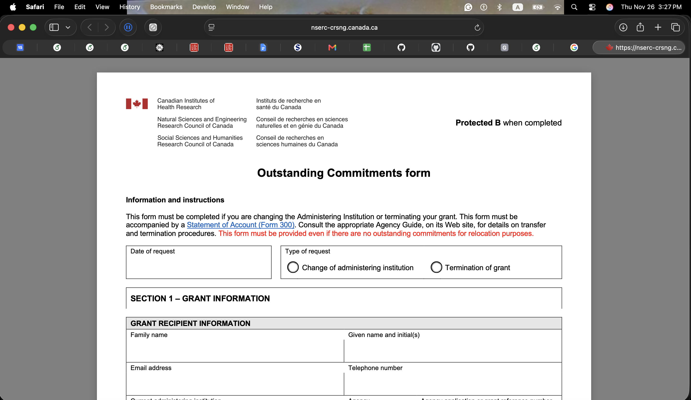

# NSERC Funding Agency

## NSERC rejected outstanding salary for research personnel in my lab

:arrow_right: I closed the three grants with a request on May 1st for an effective date on May 27th, 2025
[TabH-Termination](https://github.com/MSiam/OnDiscrimination-Canada/blob/main/Tab-H/Termination.eml). I closed these grants without sufficient HQP, yet I had reported
the CS Science Researcher, MSc students and multiple visiting students. 

:arrow_right: UBC requested the part-time CS Science
researcher in my lab to resign without my consent [TabH-RSTermination-X](https://github.com/MSiam/OnDiscrimination-Canada/tree/main/Tab-H). 

:arrow_right: NSERC refused to support her outstanding salary at UBC even when she is still research personnel in my lab paid by my
grants; also, UBC refused prior to that to switch her appointment to research associate [TabH-Outstanding](https://github.com/MSiam/OnDiscrimination-Canada/blob/main/Tab-H/Outstanding.eml). Both NSERC and UBC rejected that. 

## NSERC highlighted eligible expenses as ineligible

:arrow_right: They highlighted my planned CVPR 2025 travel
expenses as ineligible to be used from my grants, in addition to reimbursements to an MSc
visiting student in my lab [TabH-Outstanding](https://github.com/MSiam/OnDiscrimination-Canada/blob/main/Tab-H/Outstanding.eml).

:arrow_right: According to NSERC employees, **planned travel in place** is an eligible outstanding expense for postdocs or students [TabH-TravelinPlace](https://github.com/MSiam/OnDiscrimination-Canada/blob/main/Tab-H/TravelinPlace.eml), and
according to [TAGFA](https://nserc-crsng.canada.ca/en/funding/research-partnerships-and-collaborations/inter-agency/tri-agency-financial-administration-1), grants can be used to **fund research travel for the grant recipient**. Hence,it should be a valid expense. 

:arrow_right: Reimbursements for international visiting students are also valid
**under travel expenses**; it’s standard, especially from launch supplements. 

:arrow_right: A total of around 5,375 CAD was highlighted consequently from UBC as employee receivable [TabH-UBCReceivable](https://github.com/MSiam/OnDiscrimination-Canada/blob/main/Tab-H/UBCReceivable.eml),
awaiting that I send them a cheque with these! I told them this is retaliatory, clearly, and
the rules in TAGFA state that even when the outstanding expenses are rejected, **it’s the
responsibility of the administering institution**. Especially since Prof. Joanna approved both
expenses [TabH-ExpensesApproval-X](https://github.com/MSiam/OnDiscrimination-Canada/blob/main/Tab-H/ExpensesApproval-1.pdf). *“If a phase-out period is not authorized, the
administering institution is responsible for all outstanding commitments or expenditures.”*

:arrow_right: I requested a cash advance, highlighted as an outstanding expense, to pay for publication fees
for Nature Scientific Reports that was undergoing a minor revision. UBC ORS approved this
expense initially and signed [TabH-PublishFees-X](https://github.com/MSiam/OnDiscrimination-Canada/blob/main/Tab-H/PublishFees-2.pdf). NSERC rejected it. 

:arrow_right: Our paper was later accepted in Dec. 2025. That cash advance was sent to my bank account, then reversed, then
sent again two months later without my request or approval, then reversed again! Eventually,
we had to manage these publication fees through other means; it was later paid from STDF
Egypt. 

:arrow_right: I actually tried to request it as an interim remedy from BCHRTO, but they refused
[TabH-BCHRTOInterim](https://github.com/MSiam/OnDiscrimination-Canada/blob/main/Tab-H/BCHRTOInterim.pdf); for me, it was supposed to be an easy win, but they were too corrupt
and refused still. 

:arrow_right: It resulted in a 4-month delay in publishing till 13th April, 2026. We are an all-
African team; the senior and the leading authors are women, and I used NSERC as the funding
source during the original submission, as it was being reviewed. SHAME on the ones who did
this! 

:arrow_right: I received an email from UBC telling me that they will request the
MSc visiting student to pay back the reimbursements, which were 2,000 CAD [TabH-UBCReceivable](https://github.com/MSiam/OnDiscrimination-Canada/blob/main/Tab-H/UBCReceivable.eml).
I told them this is nonsense and again referred to TAGFA! 

*Even if NSERC did not approve phase-out, they still have to force the administering
institution to handle the remaining expenses per TAGFA above. They should have ensured UBC
handles these, not as a fake debt on the PI!*

## Violation of NSERC procedures in grants termination - Missing F303s

:arrow_right: I did an ATIP request in late 2025 for my grants to confirm it is terminated properly; as
expected, I found they did not submit the F303 outstanding documents. This is video of ATIP
response requesting these missing F303 documents, which still had (no F303s](https://www.youtube.com/watch?v=4VG0LnlFdbU). 

:arrow_right: I also confirmed with UBC through FOI that indeed they did not provide F303 documents [TabH-F303sMissing](https://github.com/MSiam/OnDiscrimination-Canada/blob/main/Tab-H/F303sMissing.eml). Note the NSERC document header states this clearly! Its their procedures publicly available on Government of Canada website! 

  

The reason is, once this document is signed, the money actually has to move; without this document, the
money stays where - not sure, UBC or UOIT or NSERC or floating around, God knows! All of
the aforementioned was conveyed to the NSERC secretariat as part of a complaint that was
dismissed, stating they followed standard procedures.

:arrow_right: I also did another ATIP request to see if they were crazy enough to add this as an irresponsible conduct incident in NSERC, but
thankfully they didn’t [TabH-RCR](https://github.com/MSiam/OnDiscrimination-Canada/blob/main/Tab-H/RCR.pdf).
