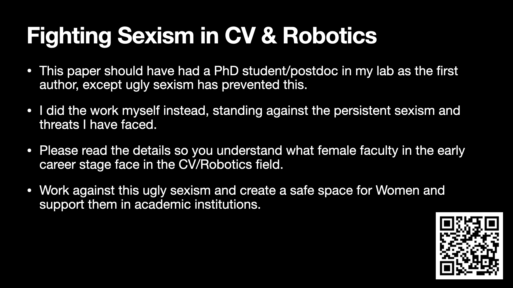

# Whistleblowing Public Canadian Institutions & Federal-level Ones

**In a country where the Law is upheld, where discrimination is fought against all of whats here in this repository should not go unnoticed.**

Create a SAFE space for Canadian women in Canada. Do not joke or redicule discrimination or belittle the women in your field or work. 

I start with the fact that I am a proud Canadian and I love their system, the country, nature, people, everything and I have been residing in Canada for more than 10 years now. 

 
I alo love NSERC and I believe its a good funding agency but its currently infested with discrimination, sexism, corruption and is under a lot of political and foreign manipulation to derail AI progress similar to whats happening in other western countries. Look at what happened in the latest Nvidia news and happy things are back to normal there now, but we all know whats happening in the field these days and similar to how its impacting major companies, startups its also impacting funding agencies.

I only focus here on sexism that happened in my story. I am declaring that from 2024 I started to feel *UNSAFE* in Canada, Egypt and the AI field generally speaking, after I held grants with NSERC and other funding agencies.

  

The above is part of my NeurIPS 2026 ED Track poster video on Slides Live soon. It is referring to my homepage which will refer to this repository for details.

### How to help:

* Ensure you star :star: this github repository. If all of this went unnoticed it becomes the normal. It does not matter how many other cases of women being promoted, they will be preys in the near future if whats here became normalized. So be proactive and ensure to fight it from now and spread the word. **Your SILENCE will empower my stalker who could be the one to inflict great harm on me.** 
* Please nominate me to this [Prize](https://cfe.torontomu.ca/awards/peter-bryce-prize-whistleblowing). Deadline is December 31st. At a time where right wing and even worse extrimists support is increasing, freedom of expression will be taken away. If we can't even talk about corruption and discrimination, even when providing real strong evidence then really its going to be an Orwellian ending. Please read that book, **Nineteen Eighty-Four, Georgoe Orwell**, if you haven't which would be shocking even teenagers should be aware of it! 
* If you are a lawyer please volunteer to help me in my legal proceedings.
* Fight against sexism, its resurging in a vicious way, only women who experienced it lately can really understand whats going on, but you might be the next victim if you aren't acting now, so act NOW.
* If you know of a woman with strong research profile and/or teaching profile in AI that hasn't landed a job yet, she is the priority to help especially if she is a Canadian woman. In summary, dont only help me, help me and others like me, especially WOMEN! Seriously if diverse Canadians aren't helped then we are faking diversity. These are the ones voting from under-represented groups so in fact they are higher priority to support against this wave calling for normalizing discrimination.

## Discrimination & Adminstrative Unfairness

To establish prima facie discrimination under Canadian human rights codes, a claimant must prove three elements on a balance of probabilities:
* **Protected characteristic:** You have a personal trait or ground protected by the relevant human rights law (for example, race, disability, sex, age, family status, or creed).
* **Adverse impact:** You experienced a negative outcome, disadvantage, or barrier in a protected area (such as employment, housing, or public services).
* **Connection:** The protected characteristic was a factor in the adverse impact—not necessarily the only reason or even the main reason.

According to the above, you do not need standalone legal entitlement to a benefit, but even if you experienced differential treatment that is linked to the protected characteristic that should be sufficient. Example being prevented from giving a talk that I was initially hosted to give, simply because I requested permission to use one quote discussing resurgent sexism and whats happening to me and women in my lab.

Similarly for discrimination on the basis of reprisal/retaliation:
* **Protected action:** You engaged in a right protected by the Code—such as filing a human rights complaint, raising an internal discrimination concern, acting as a witness, or refusing to participate in an infringement.
* **Adverse action or threat:** The respondent took a negative action against you, or threatened to do so (for example, termination, demotion, reduced hours, eviction, or harassment).
* **Intentional link:** The respondent's negative action or threat was intended as retaliation for your protected action. It does not need to be the sole motive, so long as retaliation was one of the factors behind the decision.

Now some lawyers and adjudicators in the Human Rights Tribunals, like to refer to what they call as GENERAL UNFAIRNESS. It's interesting but although it is unfair they still somehow use this trap to escape the above. Except, if they are destroying a citizen and stalking him/her too much with such GENERAL UNFAIRNESS, it still is unfair and with adverse impact. I wonder if it went to the provincial ombuds what will happen though!

## Summary of Adverse Impact

TL;DR. Pay gender gap; My grants were stolen; Fired researchers in my lab without my consent
and without approving their outstanding salaries; NSERC declared eligible expenses from my
grants as ineligible unfairly; all my academic and industry applications are rejected, even lowtier
fellowships that are at half my last salary; Fake early termination of my appointment at UBC that did not address the fact of status change to hold grants at UBC, I still have access to a lot at UBC except my grants, ability to hire HQP and email;
At zero income for almost two years; I received sexual harassment and death threats in Egypt, and I was harassed and received threats in Canada; 
Denied from my safety nets in Canada; A Canadian university denied me my publicly available PhD
and PEng credentials as such rejected my assistant prof. application; My talk was cancelled upon my request that I talk about resurgent sexism and my story; 
My birth Mom name was mysteriously changed in Egyptian records!!!!!! It’s true, no joke!; Invited as a supervisory committee member to a UBC
PhD student’s defence without affiliations or salary; I lost my car & around 15K with it; I am about to be 40 years old, and I missed my tenure & promotion to associate professor; I am still at zero monetary compensation with all of the aofrementioned happening.

## Details

* [UOIT](https://github.com/MSiam/OnDiscrimination-Canada/blob/main/UOIT.md)
* [University of British Columbia](https://github.com/MSiam/OnDiscrimination-Canada/blob/main/UBC.md)
* [NSERC](https://github.com/MSiam/OnDiscrimination-Canada/blob/main/NSERC.md)
* [Threats & Stalking](https://github.com/MSiam/OnDiscrimination-Canada/blob/main/STALKER.md)
* [Humboldt Foundation](https://github.com/MSiam/OnDiscrimination-Canada/blob/main/HUMBOLDT.md)
* [University of Victor, Canada](https://github.com/MSiam/OnDiscrimination-Canada/blob/main/UVIC.md)
* [Amii](https://github.com/MSiam/OnDiscrimination-Canada/blob/main/AMII.md)
* [NeurIPS & WiML](https://github.com/MSiam/OnDiscrimination-Canada/blob/main/NEURIPS.md)
