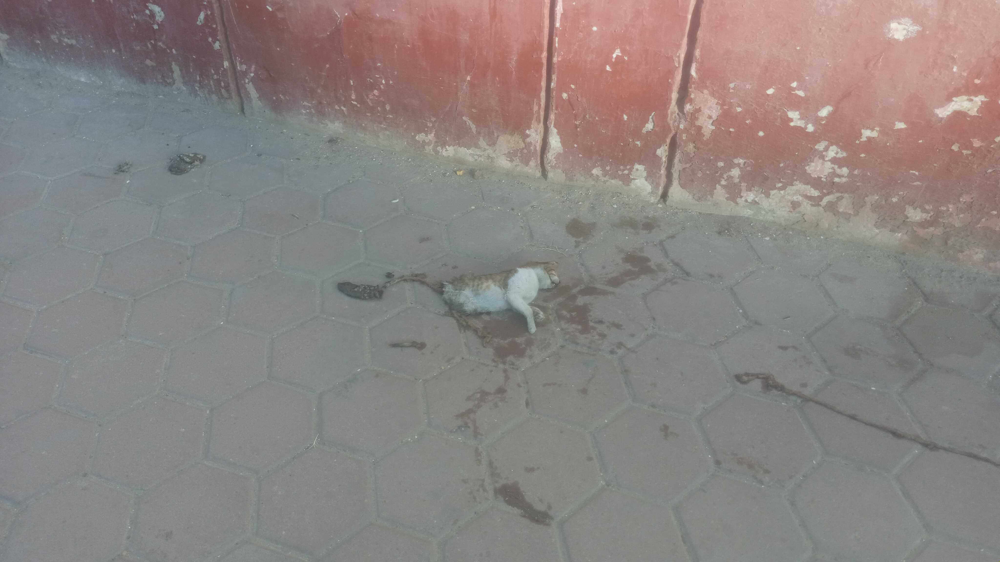

# Threats, Harrasment & Fraud Attempts

## Harrasment & Threats in Canada

In early 2024, I notified my employer that I was under severe stress after a lump in my breast was
diagnosed as suggestive of a fibroadenoma and advised to follow up at 6, 12 and 24 months. I
even sent them the medical reports and told them that I am afraid of reliving breast cancer like
my Mom and cousin, who were cured of it, but after quite the tough struggle with surgery and
chemotherapy. 

:arrow_right: When I went for the follow-up breast ultrasound that I notified em about by
late 2024, as I was busy, I found that the building security and the imaging center staff were
quite harassing to me. 

They claimed it was because I brought my bike, except I brought it with
me the first time as well without issues, as I clarified to them my plantar fasciitis that made it
intolerable to walk at that point. 

It became even worse during the Fall 2024 semester, as I was forced to teach 3 days a week, and I had to drive 2 hours back and forth from home to work. 
I used my bike for even short distances at that point, except that during my second follow-up,
they refused to allow me to undergo an examination. 

:arrow_right: I requested to reschedule, and when I showed up the third time without my bike, they brought the police for no reason; refer to [this video](https://www.youtube.com/watch?v=4VG0LnlFdbU), and I was denied the breast examination again. I had never dealt with police in Canada, where I lived for 10 years, but the police told me they won’t take this incident into any records. 

*Great because I didnt do anything wrong to begin with, they prevented me from my appointment! But more importantly, they made me realize that even police can accept such unreasonable behaviour and blame me when I am the victim.*

 Its not ok to be prevented from free healthcare. In fact just changing the imaging center, the new one surprisingly did not find the fibroadenoma at all. Maybe its the change of the device, but I was expecting a simple hey its still benign dont worry, not that it disappeared, but that was because of the change probably.

The police requested me not to video phootage his face and as such I did not.

I experienced others but I can't detail yet publicly.

However, nothing like the fact that I am prevented from my Right to WORK in Canada as a Canadian, even when I applied at really low-tier salaries some of which are less than what I was even taking in my Postdoc position. Hence, I am confident I am being stalked cause these will not be reasonably rejected under normal circumstances.

---

## Threats & Harrasment in Egypt

:arrow_right: I also share a photo of some of the threats that I am receiving, where I started finding mutilated
cat bodies on the sidewalk I regularly exercise at, two blocks from my home. 

  

Showing either the bottom half mutilated or, in another one, its body was on its back with its leg open and
hands up on a bench, something that will never happen naturally. 

:arrow_right: I also received a threat at my doorstep, as I was tear-gassed with suffocating gas when I was about to get out of my
building gate. I couldn’t breathe from its effect, and when I went out I saw a speeding car leaving at the opposite direction.

---

## Fraud attempts

:arrow_right: Now this one I can't for now detail a lot. But a government of Canada institution had an employee that faked documents that I provided, manipulated the emails and removed the official letterhead from official documents. These were used as evidence. The manipulation after it happened it was sent back to me and its extremely hard to notice these in 1000 pages document, but I did :smiley:. It saddens me but yes that is a fraud attempt, trying to manipulate evidence I provided, probably that employee was paid to do so. Hence, additional evidence on continuous stalking against me!

:arrow_right: Even worse, and the most scandalous fraud attempt I have seen in my life, I just realized that on the Egyptian records my mother’s name was modified
to my dead aunt’s name. I of course requested the fix, and I realized it purely by coincidence, but subhan Allah happy that I became aware of it to fix. But thats again another circumstantial evidence on stalking happening against me. I want to say all of these are mere errors, but they are too targeted and the errors weren't in a letter or random, they were meant to deny me either money, compensntion, rights of any sort that protects me. 

*Hence, pushing me continuously to be afraid or to fall as a prey/victim was the main goal of all of these events.* 

God protect me, but really in a good country, an investigator will be hired to investigate the stalking that is happening against me for my own protection. Especially given the evidence that I have on multiple Government of Canada or related institutions and public ones.
