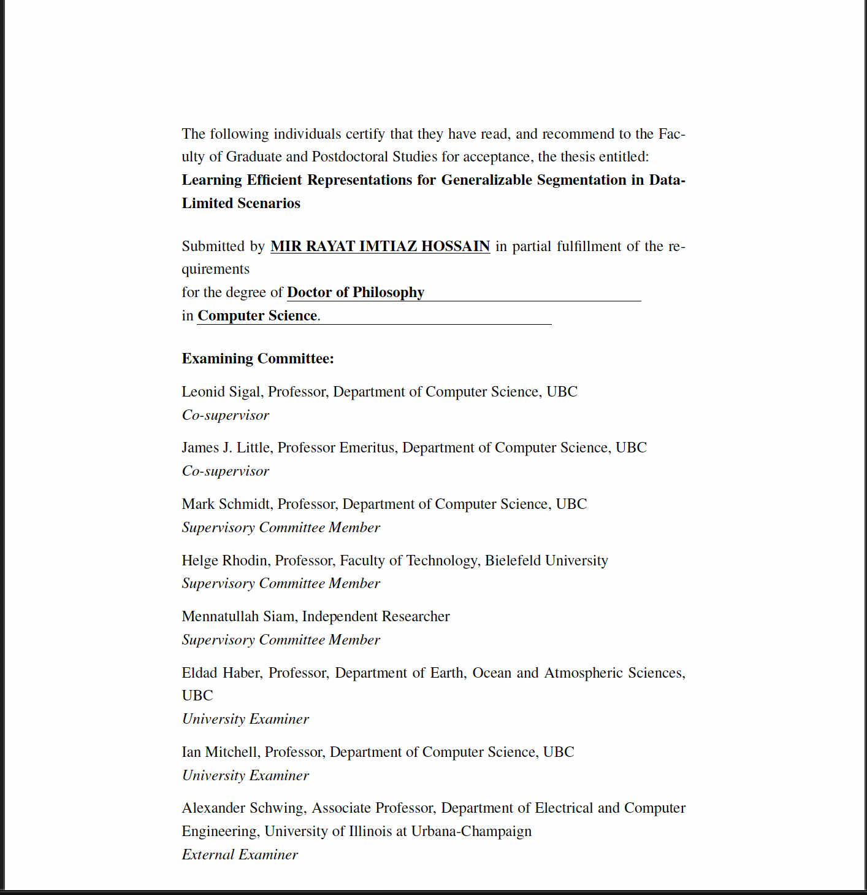

# University of British Columbia

I admit I enjoyed collaborating with UBC and UBC faculy since 2022 and initially they were quite supportive and fair. 
What happened throughout 2025 was the exact opposite and it was shocking and sexist, especially as a Hijabi Muslim woman.

:arrow_right: On Nov. 3rd, 2024, I literally fled Canada, even though I am a Canadian citizen, because I felt
unsafe and I was afraid of physical retaliation. I have lived and worked in Canada for around 10
years continuously without any interruptions, from 2015 till 2024. 

:arrow_right: I was also prevented from my safety nets in Canada because I was highlighted for voluntarily quitting without just cause. I disagreed ofc. Since then I have dual existence across both Canada & Egypt.

----

## Grants @ UBC, yet I was never invited for Round 1 Interview

:arrow_right: I migrated my NSERC grants to UBC in Nov. 2024; RGPIN-2024-04100, DGECR-2024-00468 and ALLRP 595973-2. I migrated it as
an affiliate professor, and I discussed with UBC that this is an adjunct professor in NSERC's view [Tab-D](https://github.com/MSiam/OnDiscrimination-Canada/tree/main/Tab-D), since at UBC I was informed there are no definitions for adjunct professors who
hold appointments in another academic institution ([Discussion](https://github.com/MSiam/OnDiscrimination-Canada/blob/main/Tab-D/Affiliate_Adjunct_Discussion_%40UBC.eml)). It is automatically defined as an affiliate position, which is practically the same. 

:arrow_right: I disclosed to UBC my [full situation](https://github.com/MSiam/OnDiscrimination-Canada/blob/main/Tab-E/Full_Disclosure_UOIT_toUBC_again.eml) with UOIT. I also applied concurrently to an assistant professor position in UBC’s
Statistics Department, and I had both Jim and Leon as part of my references, so I was under
the impression UBC would support me there to migrate my lab to it. 

:arrow_right: I was never shortlisted for the first round of interviews [Tab-E](https://github.com/MSiam/OnDiscrimination-Canada/tree/main/Tab-E). I couldn’t close my grants with zero formally appointed
HQP; I hadn’t hired anyone at all at that time. I only hosted a visiting PhD student in my lab
supported by my startup funds, NSERC grants and DRAC in summer 2024. I also supported
her conference travel to NeurIPS 2024 & EAAMO 2023 from my grants. I was interrupted at
UOIT due to severe discrimination I experienced. 

UBC approved the grant transfer, and the department head sent me the adjunct professor form to send to NSERC. UBC later updated
me around Nov-Dec 2024 that they updated the offer letter to affiliate assistant professor. 

----
## Denied the right to hire HQP using my grants

I held the grants at UBC till May 28th, 2025; I hired a part-time CS Science Researcher in my lab
through them, reimbursed the travel of a visiting MSc student, in addition to other expenses.
These include CVPR 2025 travel to present our workshop papers. It became a bit better than @ UOIT in that sense.

:arrow_right: I tried to hire that CS Science researcher initially as a postdoc or research scientist; I was denied this for
administrative reasons. However, publicly I am referring to her as a research scientist. 

:arrow_right: I have also put a job Ad to [hire a postdoc at UBC](https://github.com/MSiam/OnDiscrimination-Canada/blob/main/Tab-F/Postdoctoral%20Fellow%20in%20Foundation%20Models%20Research%20at%20CS%2C%20UBC%20-%20Academic%20Position%20-%20Research%20-%20Teachi.pdf). I tried to hire two postdocs
who were residing in Canada and had valid work authorization; I was prevented
from doing so. Even though they initially approved and showed support for this before I made
that Ad publicly available [Tab-F-UBCApprovalHirePostdoc](https://github.com/MSiam/OnDiscrimination-Canada/blob/main/Tab-F/UBCApprovalHirePostdoc.pdf). 

:arrow_right: I was approved to serve as part of the supervisory committee of UBC PhD student Mir Rayat Hossain with Jim and Leon [Tab-F-SupCommittee](https://github.com/MSiam/OnDiscrimination-Canada/blob/main/Tab-F/SupCommittee.eml). I was later invited to his defense without even a proper public UBC affiliation just to reduce me in front of an all MALE room, students and supervisory committee, except me.

:arrow_right: In early 2025, I also acquired approval to host a black visiting PhD student in my lab in Summer 2025, for which we acquired a Mitacs Globalink to support his project
[Tab-F-Mitacs](https://github.com/MSiam/OnDiscrimination-Canada/blob/main/Tab-F/Mitacs.pdf). That project was cancelled @ UBC.

I also had an ICCV 2023 submission with UBC being actively reviewed; it was later accepted to TMLR 2026 with a poster at ICML 2026.

----

## Fake & retaliatory early termination from UBC without Just Cause

:arrow_right: On April 29th, 2025, I received from the co-head, Prof. Margo, an early termination letter with a
month's notice [TabG-TerminationNoJustCause](https://github.com/MSiam/OnDiscrimination-Canada/blob/main/Tab-G/TerminationNoJustCause.pdf). This was retaliation after I complained to
both heads about the extremely slow processing by the CS admin staff of my request to hire
postdocs. It took more than 6 months, and I still couldn’t hire a postdoc.

:arrow_right: I had a grant deadline in May 2025 to report; it’s a small 1-year grant. They also rejected my request to
transition the CS Science Researcher to a research associate. 

:arrow_right: Their termination letter stated, *“the collaborative relationship we had envisioned with your appointment is not working. You’ve similarly expressed that you are no longer happy with this collaboration as well. In addition, we’ve confirmed that you no longer hold an academic appointment at another institution, and therefore are no longer eligible to hold an Affiliate appointment as defined under policy AP4.”*

:arrow_right: I never stated that I want to end my appointment. I complained about staff behaviour to CS
heads and the dean; when the former took no action, i.e., the termination is clearly framed as
retaliation. They were already aware of my full situation with UOIT; no change there.

:arrow_right: Except that letter only referred to my affiliate appointment, completely ignoring that, with
respect to the NSERC definition, it was an adjunct position. It also completely ignored that I
had active grants, active papers being reviewed, was on the supervisory committee of a PhD
student and had already hired the part-time CS Science researcher who worked for around two
months only. 

My term appointment with UBC should be till June, 2027. Legally, to the
best of my knowledge, termination is not viable and has multiple procedural issues aside
from its blatant discrimination and reprisal nature. 

:arrow_right: Oct. 2025, I was part of that PhD student's committee, and I was listed on his thesis as part of the supervisory committee
[TabG-RayatCommittee](https://github.com/MSiam/OnDiscrimination-Canada/blob/main/Tab-G/RayatCommittee.pdf). However, I was listed as an independent researcher instead of an
affiliate professor without my consent. I approved being written up as an
assistant/affiliate professor. I am the only woman on this supervisory committee, and the
student is male. 

  

I requested interim remedy to use my assistant prof. Position at UOIT before
that defense on his thesis in the ON HRTO but they refused [TabG-ONHRTOInterim](https://github.com/MSiam/OnDiscrimination-Canada/blob/main/Tab-G/ONHRTOInterim.pdf).
