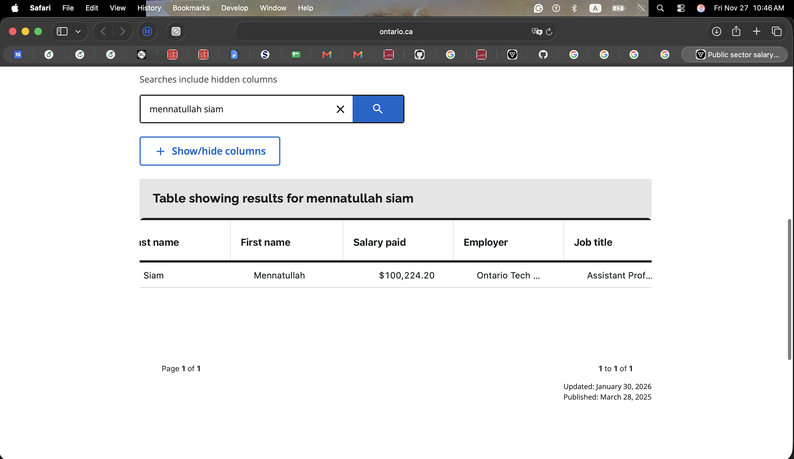

# UOIT - Public Adverse Impact

*On Oct. 4th, 2024, I Quit with Just Cause [Tab-B](https://github.com/MSiam/OnDiscrimination-Canada/blob/main/Tab-B/UOIT_ROE.pdf) from UOIT with an effective date of
Oct. 31st, 2024.* 

:arrow_right: I can’t detail the events that occurred at UOIT and the UOITFA here, I have filed two active human rights discrimination complaints against both, which are under
review. The active complaints’ file numbers with ON HRTO are **2025-62342-I, 2026-67748-I**. I
have also filed a complaint against NSERC in parallel with the CHRC, reference number
**100021410**, that hasn’t been processed yet. In addition to submitting a complaint against UBC
in the BCHRTO, case number **CS-017504**, which I withdrew because they showed clear signs
of CORRUPTION.

:arrow_right: While I have experienced severe harm in the aftermath of these events, I am still at zero
monetary compensation. I have been at zero income since Nov. 2024, beyond unsalaried affiliations. 

:arrow_right: My only current source of income is an
unlocked LIRA withdrawal that should have been left for my retirement, and it is an extremely
small amount. 

:arrow_right: I missed my tenure and/or promotion to an associate professor in 2026. 

## Gender Pay Gap
:arrow_right: I also report here the **gender pay gap and discrimination** in relation to my Hijab and my sex at UOIT
that is publicly disclosed as part of [ON public institutions in 2024](https://www.ontario.ca/public-sector-salary-disclosure/2024/all-sectors-and-seconded-employees/). 

I received around 115K initially a year as an assistant professor, that increased to around 120K near the last 4 months. This is the least in that disclosed list, while other assistant professors
were at 140-160K CAD, especially male ones. My research experience, metrics, grants, my credentials and my teaching are better than some of these by a considerable margin. Salary should be commensurate to experience!

  

