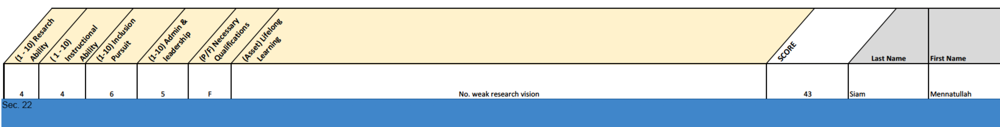
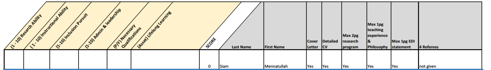
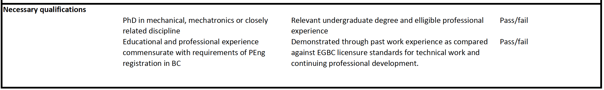
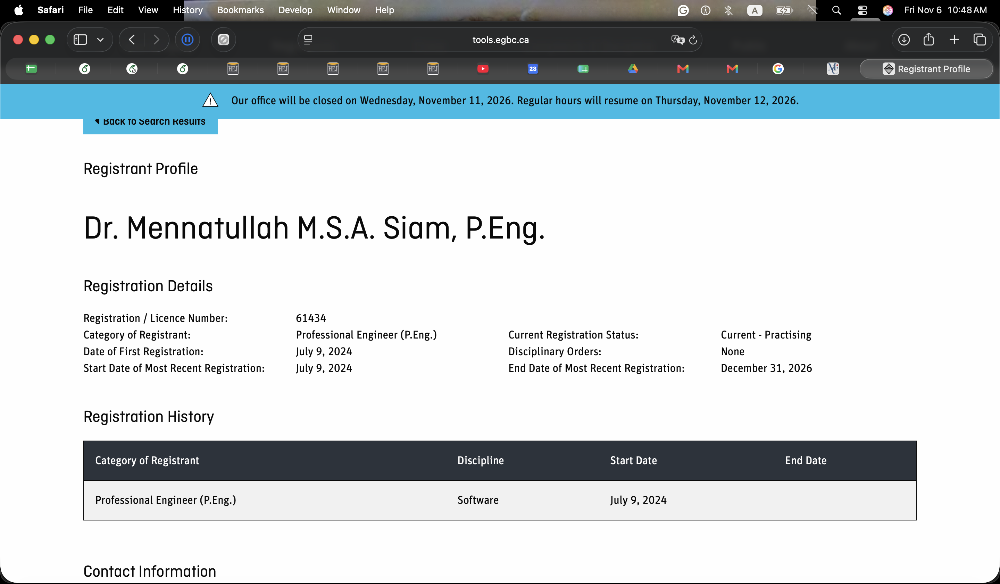

# University of Victoria

## Not acknlwedging my PhD/PEng which resulted in my faculty application rejection

I applied for a physical AI assistant professor position at UVIC. I was shocked that I was not even shortlisted for the first round of interviews for that position, and I
was notified of that by the Mechanical Engineering department chair assistant [TabJ-Rejection](https://github.com/MSiam/OnDiscrimination-Canada/blob/main/Tab-J/Rejection.eml).

I immediately submitted a Freedom of Information request to collect my scores and
evaluations from the UVIC Privacy Office [TabJ-UVICFOI-X](https://github.com/MSiam/OnDiscrimination-Canada/tree/main/Tab-J). 

* They sent me back that I was flagged for not providing four reference letters, even though I provided them in my application.
* I was also highlighted as a fail for the necessary qualifications; that is only a Fail/Pass score.
* Forget the extreme scores they provided for teaching/research which is clearly not true, but at least these are subjective. The above was clearer to me they were UNFAIR.

  
  

According to the UVIC criteria they provided in the FOI, it was only the PhD and the PEng. 

  

My PhD is in CS; However, I also have PEng with EGBC; 

  

It is due to a strong educational background in Engineering. This
relates to studying Engineering courses in my BSc, in addition to my Robotics research. So I
was 100% meeting that requirement. I sent it to the department chair, the Provost office, the equity office, the faculty relations. None helped resolve it, or even provide me an explanation on the above fatal and clear errors. 

